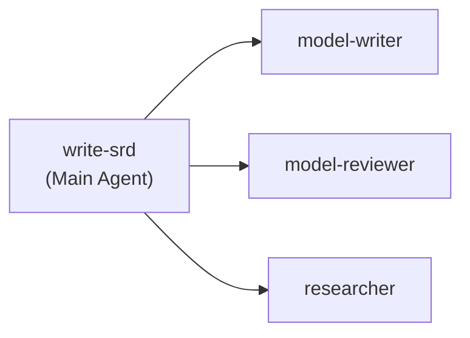
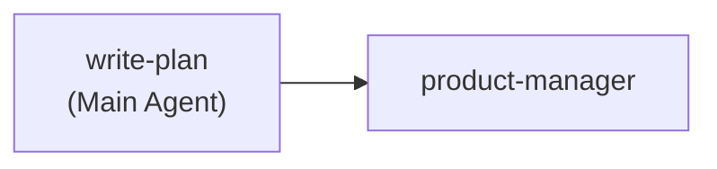
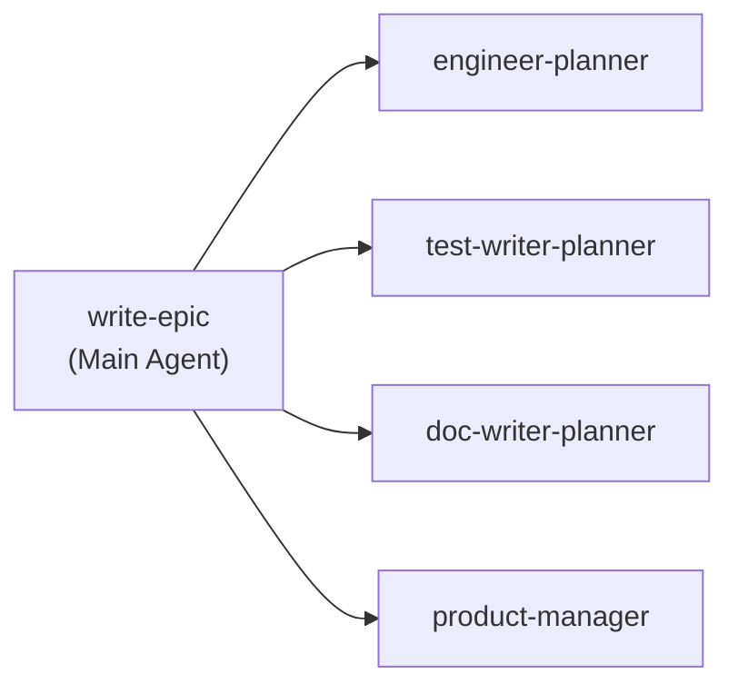
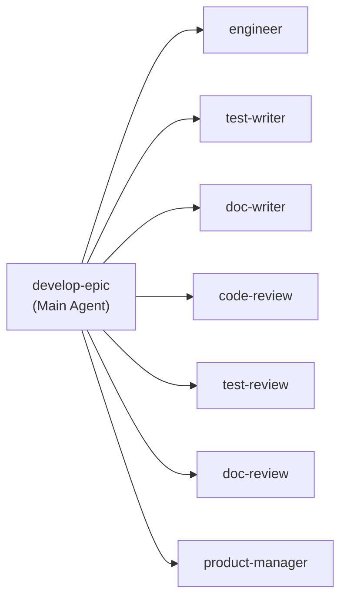
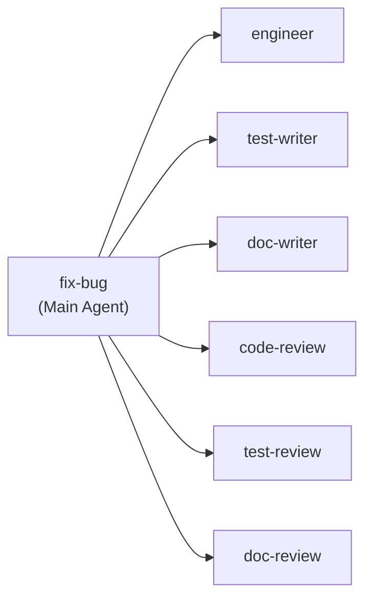
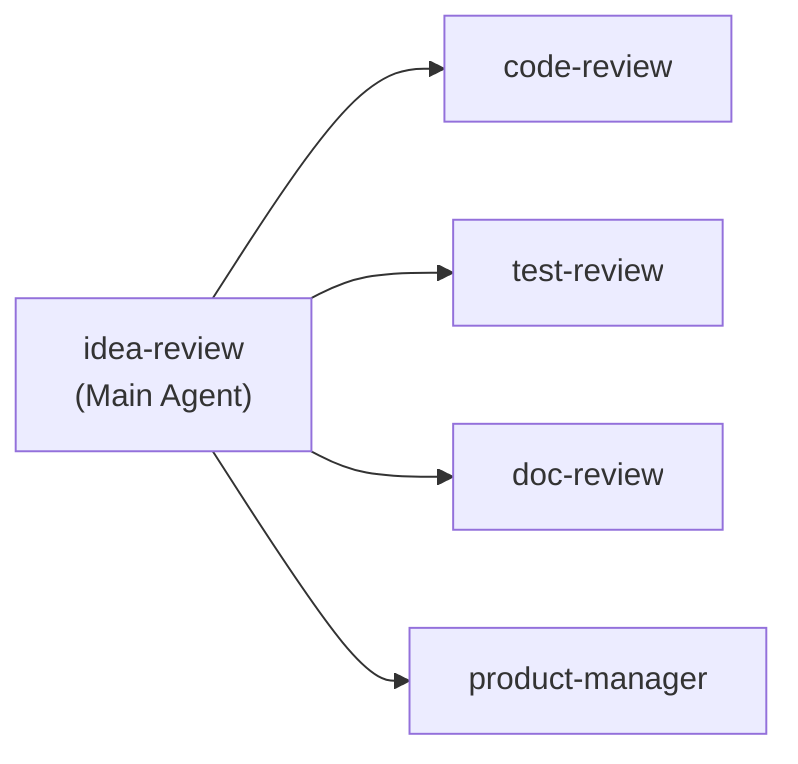

# Apiary: who runs which skill (b.v38)

- **Managing Intelligence:** runs no skills itself. It starts one Main Agent per skill.
- **Main Agent skills that launch no Child Agents:** project-setup, write-idea, write-prd, req-review, write-bug, define-bug, research, configure-worktree, teardown-worktree, release.
- **Main Agent skills that launch Child Agents:** one diagram each below.

## write-srd

## write-plan

## write-epic

## develop-epic

## fix-bug

## idea-review

Child Agent skill names are placeholders until those skills are written.
